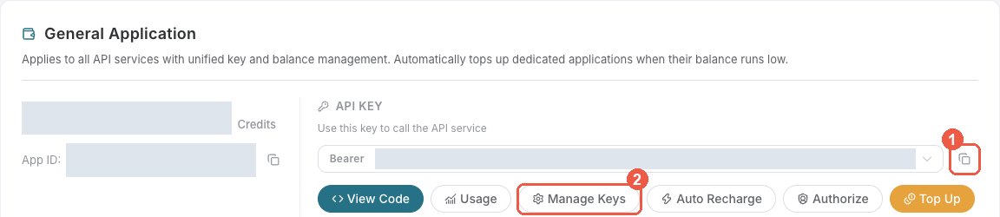
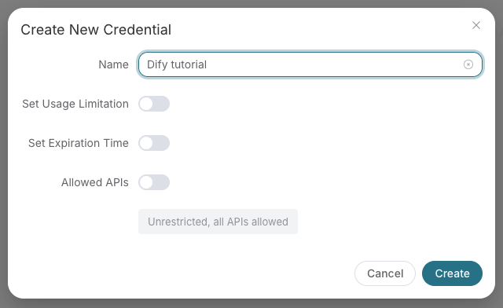

# Fish Audio

通过自己的 Ace Data Cloud 账号，在 AstrBot 对话中合成短 MP3 语音、查找公开音色。插件提供 `fish_generate_speech` 和 `fish_search_voices` 两个工具。

Ace Data Cloud 发布并维护这个独立 AstrBot 集成。请使用自己的 Ace Data Cloud API Key。

[English guide](../README.md) · [Fish TTS API](https://platform.acedata.cloud/documents/fish-tts?utm_source=astrbot&utm_medium=referral&utm_campaign=evergreen) · [Fish 音色检索](https://platform.acedata.cloud/documents/fish-model-query?utm_source=astrbot&utm_medium=referral&utm_campaign=evergreen) · [当前价格](https://platform.acedata.cloud/models?utm_source=astrbot&utm_medium=referral&utm_campaign=evergreen)

## 1. 查找与安装

市场上架后，打开 **插件 → 插件 → 插件市场**，搜索 **Fish Audio** 并核对作者 **acedatacloud**。

从 GitHub 安装时，打开 **插件 → 插件 → 已安装 → 安装插件（+）→ 从链接安装**，输入 `https://github.com/AceDataCloud/FishAudioAstrBot`。确认 Fish Audio 已启用后，在聊天中输入 `/fish_ace` 查看配置信息和工具名称。该帮助命令无需凭据，也不会请求服务。

## 配置 Key

首次使用请先注册并登录；如果应用页还没有通用应用，点击 **初始化通用应用（Initialize General Application）**，再按下面步骤管理密钥。

到 [Ace Data Cloud Applications](https://platform.acedata.cloud/console/applications?utm_source=astrbot&utm_medium=referral&utm_campaign=evergreen) 复制 General application 的生成 API Key，或创建同时允许 `/fish/tts` 和 `/fish/model` 的 Key。调用前检查 Fish Audio 当前价格和余额。在插件设置 **Ace Data Cloud API key with Fish Audio access** 中粘贴 Key 本身；不要加 `Bearer `，也不要使用 `platform-...` 管理 Token。AstrBot WebUI 会遮蔽字段，但数据目录会保存原值，请保护该目录。

选择支持工具调用的聊天模型，并在当前 Profile 和 Persona 里允许 `fish_generate_speech`、`fish_search_voices`。

### Token 图文：复制或创建专用 Key

先[注册或登录 Ace](https://platform.acedata.cloud/console/applications?utm_source=astrbot&utm_medium=referral&utm_campaign=evergreen)，打开 **Applications → General application**；没有通用应用时先初始化。图中 **1** 复制现有 Key，**2 Manage Keys → Create** 创建专用 Key。API 限制开启时应包含 `/fish/model`、`/fish/tts`，并检查账户当前权限、余额与价格。

专用 Key 可命名为 `AstrBot Fish Audio`；到期和限额按需设置。下图中的 `Dify tutorial` 是旧示例名称，不需要照抄。

两张图于 **2026-10-19** 复用核验，原拍摄日期未知，凭据/App ID/余额均已脱敏；这是共享 Ace Applications 页面，不是 AstrBot 安装或真实调用证明。[原图来源与限制](../_assets/tutorial/sources.json)。

### 在 AstrBot 填写哪里

打开 **插件 → 插件 → 已安装**，点击 **Fish Audio** 卡片齿轮（插件配置），在 **Ace Data Cloud API key with Fish Audio access**（字段 `api_key`）粘贴 Key 并保存。只填 Key 本身，不加 `Bearer `；不填到模型提供商或聊天消息。界面遮罩不加密磁盘配置，请保护 AstrBot 数据目录。此处提供准确文字路径；不以假界面代替本插件最新设置截图。

## 在聊天中使用

默认音色短语音示例：

> 只调用一次 `fish_generate_speech`，用 `s2-pro` 朗读“你好，AstrBot”，给我完成后的 MP3 链接。

工具同步调用一次 `POST /fish/tts`，把模型放在 HTTP `model` 请求头，发送 `format: "mp3"`，返回完成后的 `audio_url`。可显式选择 `s1`、`s2-pro` 或 `s2.1-pro`；插件不会自动切换模型或重试付费请求。单次文本上限为 4096 UTF-8 字节。

查找公开音色示例：

> 用 `fish_search_voices` 查找名称含“narration”的英语音色，返回最多五个 `reference_id` 和 `state`。

将已训练音色的 `reference_id` 传给 `fish_generate_speech`。音色 ID 可留空。首版支持公开或自己已有的音色 ID，不创建音色，也不接收参考音频做克隆。请仅使用有权使用的音色。

## 用量与排障

到 Ace Data Cloud 应用用量页核对返回的 trace ID。若响应没有 trace ID，按 API 和时间筛选只能得到关联线索，不能精确归属某条账单。Fish TTS 按目标文本的 UTF-8 字节数计费；以当前价格为准。音色检索与语音合成是不同请求。

| 现象 | 检查项 |
| --- | --- |
| 插件加载失败 | AstrBot 版本、**Failed to Load Plugins**、**Data & Logs → Logs**。 |
| 看不到工具 | 插件启用、当前 Profile/Persona 允许工具、聊天模型支持工具调用。 |
| HTTP 401/403 | Key 类型、Allowed APIs 路径和账号权限。 |
| 网络错误或缺少音频 URL | 再次生成前查请求历史；超时的请求可能已产生费用。 |
| 未查到音色 | 扩大名称范围或取消语言筛选，只选已训练的音色。 |

Key 只发送到 `https://api.acedata.cloud`，重定向会被拒绝。插件只向模型返回完成后的音频链接或精简公开音色字段，不透出上游原始响应。运行只需 Python 标准库。

## 已验证的本地运行与图标

官方 AstrBot `v4.28.2` 的隔离实例以 editable 方式加载两个工具。ChatUI 对 `fish_search_voices` 调用一次，得到 3 个公开音色结果；另一个会话对 `fish_generate_speech` 调用一次，以 `s2-pro` 合成一段短文本。返回的 MP3 链接为 HTTP 200、`audio/mpeg`，`ffprobe` 解码时长约 1.698 秒。响应没有 trace ID，因此不声称精确匹配某条用量记录。[脱敏结果](../tests/e2e-results.json)记载了验证边界。

本集成的图标采用语音气泡和波形主题。[矢量源文件](../logo.svg)。
